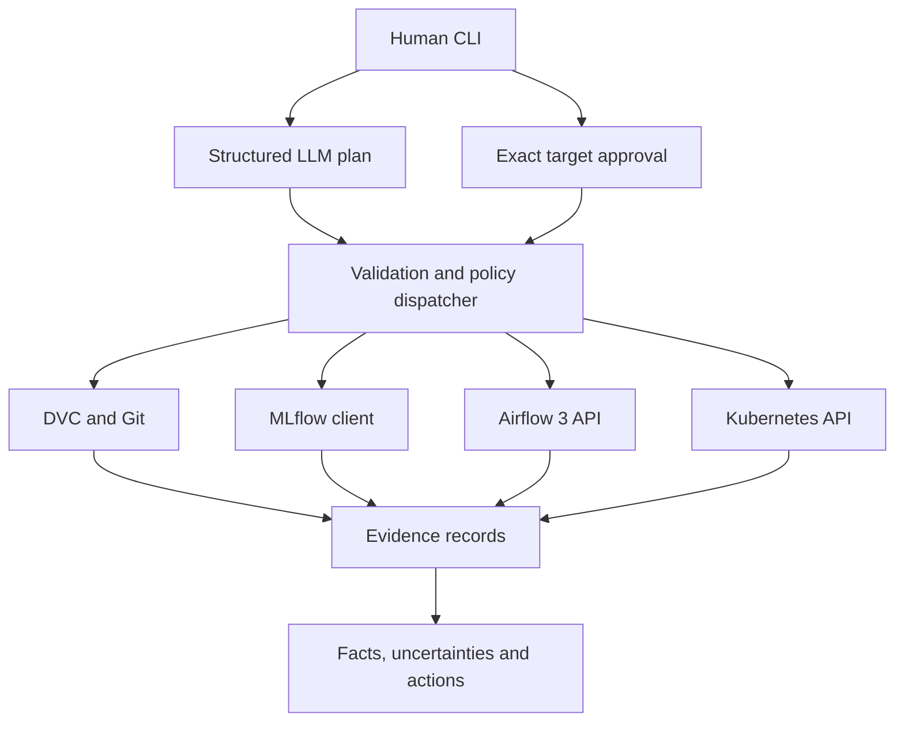

# System architecture

The language model chooses a bounded plan, not arbitrary Python or shell commands.
The CLI has an explicit deterministic router for offline testing and a `--llm`
mode using OpenAI's structured response API. The offline router is not an LLM.
Operational summaries are produced from tool records by deterministic code, so
unavailable tools cannot be replaced with generated operational assertions.

Every record includes request ID, tool, operation, status, elapsed milliseconds,
data and a sanitized error. Logs omit payloads and error bodies. Returned evidence
scrubs runtime secrets and common credential fields. Treat logs as potentially
sensitive: redaction is best effort, not a general data-loss prevention system.

## Trust and permissions

| Module | Callable operations | Permission |
|---|---|---|
| DVC | datasets, version, diff, status, reproduce | Read-only commands; reproduce returns instructions |
| MLflow | experiments, runs, run, best, compare, registry | Tracking/registry reader |
| Airflow | dags, runs, tasks, logs | Authenticated reader; approved training DAG only |
| Airflow | trigger | Exact `airflow.trigger:iris_training` approval |
| Kubernetes | pods, deployments, services, events, logs | Approved namespace, application labels |
| Kubernetes | restart | Exact namespace/deployment approval and RBAC patch permission |

Authorization is supplied out of band from the CLI. The model cannot set a
`confirmed` field: unknown fields are rejected. A malicious or mistaken plan can
request a write, but the dispatcher denies it without the human's exact grant.
The public orchestration boundary is `Agent.dispatch`; adapter classes are internal
implementation APIs and must not be exposed directly in a server.

Kubernetes defaults to reader-only RBAC. Restart is implemented but will still be
rejected by the cluster unless an administrator separately grants narrowly scoped
patch permission. Namespace checks run before connecting to Kubernetes.

## Data and training lineage

`data/iris.csv.dvc` stores the dataset's content hash. Training checks that the
actual CSV, working DVC pointer and committed DVC pointer agree before logging a
run. MLflow stores the Git commit, DVC MD5, dataset path, dirty-code indicator,
model parameters, F1, accuracy, quality gate and model artifact. A previous Git
commit plus a populated DVC remote reconstructs the dataset.

Training uses a fixed stratified split. StandardScaler fits inside the pipeline
on training data only. F1 is macro-averaged across the three classes. Airflow runs
validation → preprocessing → training → evaluation/MLflow → quality gate. Tasks
retry twice, use run-specific directories, and require successful upstream tasks.
No DAG stage promotes or deploys a model automatically.

## Runtime boundaries

The inference service loads a trusted local artifact. Liveness means the process
responds; readiness requires a loaded model. Kubernetes requests two replicas and
provides a ClusterIP service, resource limits, probes and non-sensitive ConfigMap.
The agent does not equate a Deployment's desired replica count with availability.

The demonstration uses a local Airflow standalone installation and SQLite-backed
MLflow. These are teaching environments, not highly available production services.
A production deployment needs authenticated TLS endpoints, managed storage,
centralized audit logs, multi-user authorization, signed artifacts and immutable
image digests. The joblib artifact format is trusted-code input, never user upload.
