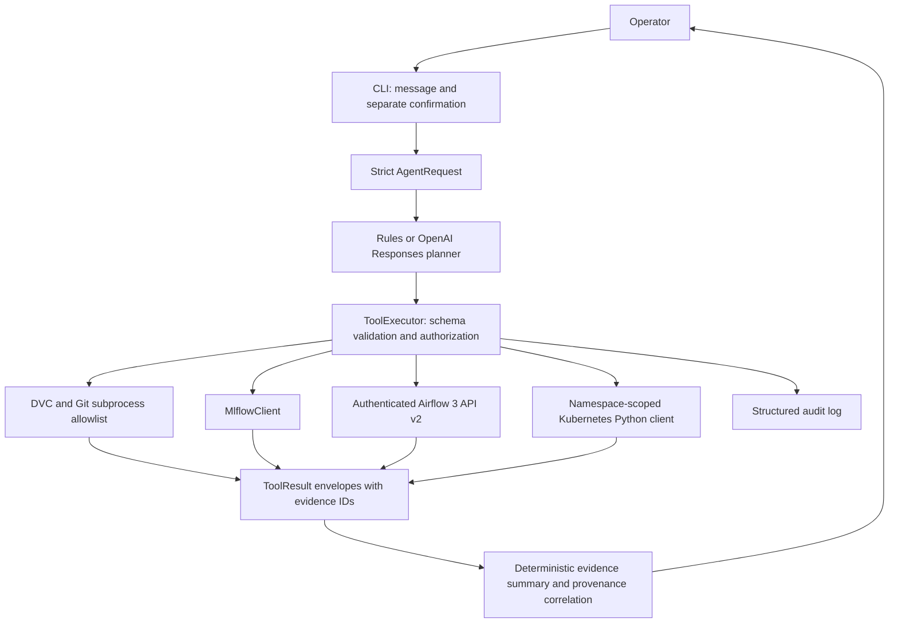

# MLOps AI Agent architecture

The agent turns a user request into bounded operations against DVC, MLflow, Airflow 3 and Kubernetes. Every operational result is attached to a tool response. The interface returns facts, uncertainties, recommendations and the underlying evidence separately.

## Request, planning and evidence

`agent/main.py` exposes single requests, an interactive read interface and `--list-tools`. `AgentRequest` rejects unknown fields and bounds message length. `ToolExecutor` derives input schemas from the registered methods, rejects extra arguments and uses strict runtime validation. The public catalogue has 24 functions: five DVC, six MLflow, six Airflow and seven Kubernetes functions.

The default `rules` mode supports the assignment's main requests without an API key. A structured request, `tool <registered_name> <JSON object>`, exposes every operation. The `llm` mode sends the same tool schemas to the OpenAI Responses API and returns function results as `function_call_output` records. Planning is bounded by a step limit. Tool output is described to the planner as untrusted data. The model's final prose is excluded from the report; application code renders the recorded evidence instead. See the supported [OpenAI function-calling flow](https://developers.openai.com/api/docs/guides/function-calling).

The mandatory mixed assessment has an explicit dependency graph in both modes:

1. Select a candidate among recent completed MLflow runs with a finite requested metric.
2. Read the Git commit and dataset reference recorded on that run.
3. Inspect the historical DVC pointer at that commit and compare its hash with the run's recorded hash.
4. Inspect current DVC changes, Kubernetes application health and recent Airflow runs.
5. Explain recorded facts and missing evidence. A hash mismatch becomes an uncertainty that requires investigation.

This graph never invokes a training mutation. `MODEL_MAX_AGE_DAYS`, when explicitly configured and exceeded, supports a retraining recommendation. Without a freshness policy, recorded failed gate or supplied degradation evidence, necessity remains undetermined. A failed deployment establishes an operational problem; it does not establish model degradation.

Each `ToolResult` has a unique `evidence_id`, request ID, tool name, status, duration, data and optional error. The statuses are `ok`, `invalid`, `denied`, `timeout` and `unavailable`. Failed calls have no operational data. A timeout means the outcome is uncertain, particularly for writes; the caller should inspect state before retrying.

## Integration boundaries

| Integration | Implementation | Evidence and restrictions |
| --- | --- | --- |
| DVC | `agent/tools/dvc_tools.py` uses argument arrays, no shell interpolation, and timeouts. | Only approved Git/DVC reads execute. Relative pointer paths and single revisions are validated. Historical metadata is read without changing the working checkout. Reproduction guidance and the collector use isolated copies. |
| MLflow | `agent/tools/mlflow_tools.py` uses supported `MlflowClient` methods. | Runs retain parameters, metrics, tags and provenance. Candidate ranking excludes failed, missing-metric and nonfinite-metric runs. Registry information is returned when available. |
| Airflow 3 | `agent/tools/airflow_tools.py` sends JWT-authenticated requests to `/api/v2`. | Reads cover DAGs, runs, task states and logs. Only an allowlisted DAG can be triggered after explicit approval. Client-generated run IDs aid inspection after uncertain acceptance; POST is not automatically retried. |
| Kubernetes | `agent/tools/kubernetes_tools.py` uses the Python SDK with in-cluster or kubeconfig credentials. | Reads and writes are restricted to `KUBE_NAMESPACE`, default `mlops`. Inspection covers Deployments, Pods, Services, events and bounded logs. Restart is the sole exposed cluster mutation. |

DVC pointers identify content and Git identifies the recorded source state; retrieving the data also needs accessible cache or remote storage. See [DVC checkout semantics](https://doc.dvc.org/command-reference/checkout). MLflow queries use the [Python client interface](https://mlflow.org/docs/latest/api_reference/python_api/mlflow.client.html). Airflow authentication follows its [public API JWT boundary](https://airflow.apache.org/docs/apache-airflow/stable/security/api.html).

## Confirmation and credential boundary

The operator supplies `--confirm airflow_trigger_dag` or `--confirm kubernetes_restart_deployment` separately from the message. `confirmed` is omitted from all planner-visible schemas. The executor checks the trusted request's `confirmed_tools` list, then injects `confirmed=True` into an approved mutation. Supplying `confirmed` through model-generated arguments fails schema validation. The integration also checks approval, the DAG allowlist or the namespace before contacting the service.

The Kubernetes reader Role grants only get/list access to the necessary resources. Optional restart RBAC is separate and restricts patch access to `prediction-api`. Cluster credentials should use those roles; a broad local administrator kubeconfig does not demonstrate least privilege. Inference Pods do not mount a service-account token.

Audit records contain only tool name, status, duration, request ID and evidence ID. Inputs, raw outputs and raw exception messages are excluded. Evidence redaction removes common secret keys, bearer tokens, credentialed URLs and secret assignments. The evidence collector additionally removes values found in known secret environment variables. Redaction is defense in depth; credentials belong in environment variables or credential stores, and exports should be reviewed before submission.

## Training and serving path

```mermaid
flowchart LR
    Data[DVC dataset and Git reference] --> Validate[validate]
    Validate --> Prepare[preprocess]
    Prepare --> Train[train]
    Train --> Evaluate[evaluate_and_log / MLflow]
    Evaluate --> Gate[quality_gate]
    Gate -->|passed| Artifact[Approved local model and metadata]
    Artifact --> Build[Explicit image build]
    Build --> Deploy[Explicit Kubernetes deployment]
    Deploy --> Service[ClusterIP Service]
    Service --> Replicas[Two inference replicas]
```

The Airflow Task SDK DAG calls shared functions from `training/train.py`. Validation checks schema, numeric values and class coverage before preprocessing. Training uses a fixed stratified split and random seed. The recorded dataset hash must match the DVC pointer. MLflow records evaluation metrics, parameters, dataset provenance and quality-gate state.

The DAG contains the five required stages, two retries with exponential backoff, execution timeouts, explicit task dependencies and one active run. A failed validation prevents training. A failed quality gate raises an error and prevents approving that candidate. Successful Airflow runs write to per-run artifact directories; deployment remains an explicit operator action.

The FastAPI application loads only model metadata marked `quality_gate=passed`. `/health/live` checks process responsiveness, `/health/ready` checks approved-model availability, `/version` exposes application/model provenance, and `/predict` validates four finite nonnegative Iris features per instance. A model-load failure keeps the process alive and makes readiness return 503.

Kubernetes configuration requests two replicas, a ClusterIP Service, startup/readiness/liveness probes, CPU/memory requests and limits, and a ConfigMap for non-sensitive settings. Pod security disables privilege escalation and uses a non-root user and a read-only root filesystem. Readiness controls endpoint participation; liveness failures can restart a container. These have distinct purposes, as described in the [Kubernetes probe documentation](https://kubernetes.io/docs/tasks/configure-pod-container/configure-liveness-readiness-startup-probes/).

`deployment_health` checks observed rollout generation, desired/updated/ready/available replicas and Pod readiness. It exposes restarts, waiting/termination reasons and events. That is cluster readiness evidence, not an end-to-end guarantee that prediction requests succeed. A separate prediction request is needed to establish the latter.

## Validation and evidence

Ordinary pytest runs inject service doubles and an HTTPX mock transport. They test actual routing, schema and permission enforcement, timeouts, service failures, absent evidence, provenance correlation and LLM function-loop behavior without live credentials. Training and inference tests execute local model logic. DAG structure tests validate dependencies; they do not substitute for a real scheduler run.

`scripts/collect_evidence.py` exports five timestamped agent conversations plus optional pipeline follow-up and isolated dataset reproduction. It records outages as observed outages. `--trigger` separately authorizes a real training run. See [the evidence index](evidence/README.md) for the actual verification state and exported observations, [the technical report](docs/technical_report.md) for rubric coverage, and [the defense guide](docs/defense.md) for the demonstration sequence.
